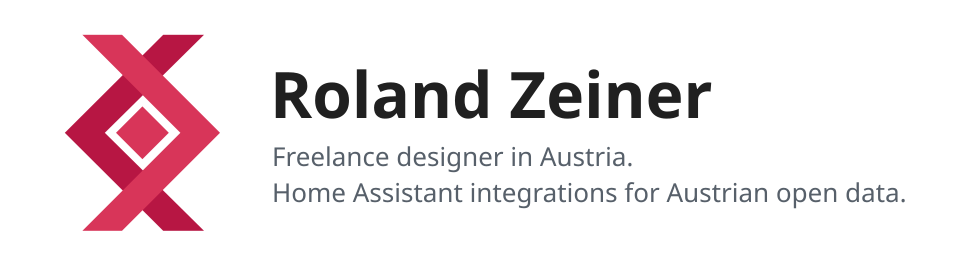
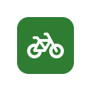
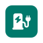

<picture>
  <source media="(prefers-color-scheme: dark)" srcset="assets/header-dark.svg">
  
</picture>

Freelance media technician from Austria: graphic design, web design, Laravel (TALL Stack), WordPress, MadStack and vector animation.

Here on GitHub I build [Home Assistant](https://www.home-assistant.io/) integrations for Austrian public data, plus a few Lovelace cards. Everything installs through the [Marketplace](https://www.home-assistant.io/integrations/marketplace/) and speaks English and German.

## Home Assistant integrations

**Getting around**
-  [wiener-linien-austria](https://github.com/rolandzeiner/wiener-linien-austria): live departures for Vienna's public transport
-  [linz-linien-austria](https://github.com/rolandzeiner/linz-linien-austria): live departures for LINZ AG LINIEN
-  [nextbike-austria](https://github.com/rolandzeiner/nextbike-austria): nextbike stations in Vienna, Lower Austria, Tyrol, Linz and Klagenfurt

**Fuel and charging**
-  [tankstellen-austria](https://github.com/rolandzeiner/tankstellen-austria): fuel prices from E-Control's Spritpreisrechner
-  [ladestellen-austria](https://github.com/rolandzeiner/ladestellen-austria): EV charging stations from E-Control's Ladestellenverzeichnis

**Environment**
-  [badegewaesser-austria](https://github.com/rolandzeiner/badegewaesser-austria): water quality at Austria's 260 official bathing sites (AGES)

## Lovelace cards and tools

-  [austria-map-card](https://github.com/rolandzeiner/austria-map-card): zoomable map of Austria with provinces, districts and municipalities
-  [orrery-card](https://github.com/rolandzeiner/orrery-card): the solar system in 3D, with real planet positions for any date
-  [spinning-wheel-card](https://github.com/rolandzeiner/spinning-wheel-card): a prize wheel you can click or flick
-  [webcam-timelapse](https://github.com/rolandzeiner/webcam-timelapse): archives any webcam and lets you scrub back through it

Found a bug or have an idea? Open an issue in the project's repository.
